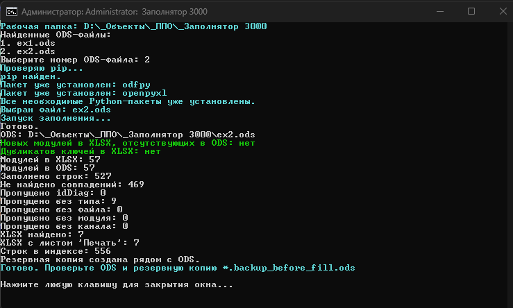
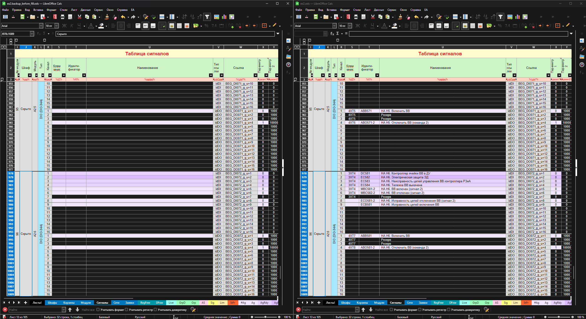

# Заполнятор 3000



**Заполнятор 3000** (`Zapolnyator3000`) — Windows-инструмент для автоматического заполнения листа `Сигналы` в ODS-файле по данным из XLSX-файлов.

Публичный репозиторий: [MostlyDeterministic/zapolnyator-3000](https://github.com/MostlyDeterministic/zapolnyator-3000)

## Что делает

Программа ищет XLSX-файлы в выбранном рабочем каталоге и вложенных папках, считывает лист `Печать`, сопоставляет найденные данные со строками листа `Сигналы` в ODS и заполняет целевые поля.

Сопоставление выполняется по набору признаков:

- обозначение шкафа или имя исходного файла;
- корзина;
- позиция модуля;
- номер канала;
- тип сигнала.

## Пример результата



Слева — обезличенный фрагмент листа `Сигналы` до обработки, справа — тот же фрагмент после сопоставления с данными XLSX. Во время обработки программа также создаёт резервную копию исходного ODS и выводит диагностику: количество заполненных строк, отсутствующие совпадения, дубликаты и новые модули.

## Возможности

- поиск XLSX-файлов во вложенных каталогах;
- чтение листа `Печать`;
- определение используемых колонок ODS по маркерам третьей строки листа `Сигналы` вместо жёстко заданных букв, с поддержкой старых и новых расположений колонок;
- заполнение листа `Сигналы` в ODS;
- распознавание DI и DO для модулей DM;
- нормализация похожих кириллических и латинских символов;
- пропуск диагностических сигналов `idDiag`;
- обнаружение дублирующихся составных ключей;
- обнаружение новых модулей, отсутствующих в ODS;
- создание резервной копии исходного ODS;
- вывод статистики обработки и диагностических сообщений;
- запуск через CMD/PowerShell;
- проверка наличия Python, `pip` и необходимых библиотек;
- предложение установки Python через `winget` и зависимостей через `pip`.

## Требования

- Windows 10 или Windows 11;
- Windows PowerShell 5.1 или новее;
- Python 3;
- Python-библиотеки `odfpy` и `openpyxl`.

При первом запуске оболочка может предложить автоматически установить Python через `winget`, а затем установить отсутствующие библиотеки через `pip`. После успешной установки выполнение обычно продолжается в том же окне.

Для автоматической установки Python требуется доступный `winget`. При его отсутствии Python можно установить вручную.

## Быстрый запуск

Поместите в один рабочий каталог:

- `fill_signals_ods.py`;
- `run_zapolnyator_3000.cmd`;
- `run_fill_signals_ods.ps1`;
- целевой ODS-файл;
- исходные XLSX-файлы.

Рекомендуемый запуск на Windows — двойной щелчок по:

```text
run_zapolnyator_3000.cmd
```

CMD-оболочка запускает PowerShell для текущего процесса с политикой `Bypass`, не меняет постоянные системные настройки и оставляет окно открытым после завершения или ошибки.

Альтернативный запуск из PowerShell:

```powershell
powershell.exe -NoLogo -NoProfile -ExecutionPolicy Bypass -File ".\run_fill_signals_ods.ps1"
```

После запуска:

1. выберите ODS-файл из предложенного списка;
2. дождитесь завершения обработки;
3. проверьте обновлённый ODS;
4. проверьте резервную копию `*.backup_before_fill_*.ods`;
5. просмотрите диагностические сообщения и итоговую статистику.

## Запуск Python напрямую

```powershell
python .\fill_signals_ods.py ".\example.ods"
```

Без создания резервной копии:

```powershell
python .\fill_signals_ods.py ".\example.ods" --no-backup
```

Режим без резервной копии рекомендуется использовать только при наличии другой сохранённой копии документа.

## Ожидаемые данные

ODS-файл должен содержать лист:

```text
Сигналы
```

XLSX-файлы должны содержать лист:

```text
Печать
```

В текущей версии исходные табличные файлы поддерживаются в формате `.xlsx`.

Названия листов, начальная строка обработки ODS (5) и колонки XLSX задаются константами в `fill_signals_ods.py`. Колонки ODS определяются автоматически по точным маркерам в третьей логической строке листа `Сигналы`:

| Назначение | Маркер ODS | Источник XLSX |
|---|---|---|
| Шкаф | `%uso%` | Имя XLSX-файла |
| Корзина | `%rack%` | `F` |
| Позиция модуля | `%mobPos%` | `G` |
| Канал | `%chanel%` | `H` |
| Тип сигнала | `%!LinkType?%` | `E` и `H` |
| Клеммник | `%XT%` | `M` |
| Идентификатор | `%ID%` | `C` |
| Наименование | `%caption%` | `D` |

Если обязательный маркер отсутствует или встречается более одного раза, программа прекращает работу с ошибкой **до сохранения ODS**. Запасного перехода на фиксированные столбцы нет: это защищает от записи в неверные поля.

Для запуска достаточно **одного XLSX**, если необходимо обновить данные одного шкафа. Сопоставление производится только с найденными файлами. Следует проверить статистику совпадений после выполнения.

## Безопасность данных

Программа изменяет выбранный ODS-файл непосредственно на диске.

По умолчанию перед сохранением создаётся резервная копия:

```text
имя_файла.backup_before_fill_ГГГГ-ММ-ДД_ЧЧ-ММ-СС.ods
```

Копии каждого запуска сохраняются отдельно. При совпадении даты и времени до секунды добавляется уникальный суффикс `_001`, `_002` и т. д. Старые резервные копии формата `*.backup_before_fill.ods` также исключаются из меню выбора ODS.

Перед работой с важными документами рекомендуется проверить сценарий на копиях.

Реальные производственные документы не должны храниться в репозитории.

## Ограничения

- исходные табличные файлы поддерживаются в формате `.xlsx`;
- структура входных таблиц должна соответствовать ожидаемому формату;
- листы должны называться `Сигналы` и `Печать`;
- названия листов и начальная строка обработки ODS, а также номера колонок XLSX задаются в коде; ODS-колонки определяются по восьми обязательным маркерам в строке 3;
- при повторяющемся составном ключе используется первая найденная запись, остальные выводятся как дубликаты;
- автоматическая установка Python и библиотек зависит от доступности `winget`, `pip` и сетевого доступа.

## Разработка

Основные технологии:

- Python 3;
- Windows PowerShell;
- odfpy;
- openpyxl;
- ODS;
- XLSX.

Основные файлы проекта:

```text
zapolnyator-3000/
├── assets/
│   ├── branding/
│   │   └── MD.png
│   └── screenshots/
│       ├── main-window.png
│       └── before-after.png
├── fill_signals_ods.py
├── tests/
│   └── test_ods_header_mapping.py
├── run_zapolnyator_3000.cmd
├── run_fill_signals_ods.ps1
├── requirements.txt
├── .gitignore
└── README.md
```

Рабочие ODS/XLSX-документы, резервные копии, Python-кэши и локальные окружения не хранятся в Git.

Базовые регрессионные тесты с полностью синтетическими документами:

```powershell
python -m unittest discover -s tests -v
```

Они проверяют старую, новую и смещённую структуру колонок, ошибки обязательных маркеров, запись только в целевые поля, резервирование и обнаружение дубликата. Полную регрессию и совместимость всех производственных шаблонов эти тесты не гарантируют.

## Статус

Текущая версия: `v1.0.1`.

Изменения `v1.0.1`:

- Столбцы листа `Сигналы` определяются по маркерам третьей строки ODS, что позволяет обрабатывать старые и новые шаблоны с разным расположением полей.
- Резервные копии теперь сохраняются с датой и временем; предыдущие копии не перезаписываются, а новые и старые резервные файлы исключены из выбора исходного ODS.
- Добавлены автоматические регрессионные тесты для расположения колонок и безопасного резервирования.

Внимание: формат имени резервной копии изменился с `*.backup_before_fill.ods` на `*.backup_before_fill_ГГГГ-ММ-ДД_ЧЧ-ММ-СС.ods` (с уникальным суффиксом при совпадении времени). Если внешние скрипты опираются на старое имя, их необходимо скорректировать.

## Авторские права

Copyright © 2026 MostlyDeterministic. All rights reserved.
